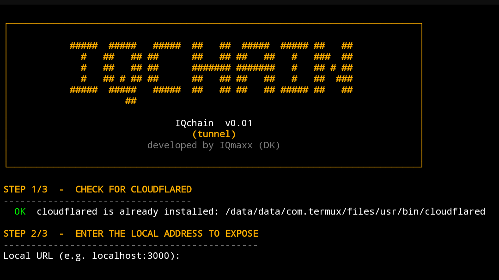

<div align="center">
  <h1>⚡ IQchain v0.01 ⚡</h1>
  <p><b>Next-Generation Cybersecurity & Network Architecture</b></p>
  
  <p>
    <a href="#"></a>
    <a href="#"></a>
    <a href="#"></a>
  </p>
</div>

<br>

<table border="0" width="100%" cellpadding="10" cellspacing="0">
  <tr>
    <td width="45%" align="center" valign="middle">
      
    </td>
    <td width="55%" align="left" valign="middle">
      <div style="font-size: 1.1em; line-height: 1.8;">
        <b>IQchain</b><br>
        <b>ஐக்யூ செயின்</b><br>
        <b>आईक्यू चेन</b><br>
        <b>Cadena de IQ</b><br>
        <b>Chaîne de QI</b><br>
        <b>IQ-Kette</b><br>
        <b>IQ链</b><br>
        <b>IQチェーン</b><br>
        <b>IQцепь</b><br>
        <b>آي كيو تشين</b>
      </div>
    </td>
  </tr>
</table>

<br>

<!-- Dark Bolded Tunnel Section under Logo -->
<div align="center" style="background-color: #1a1a1a; color: #ffffff; padding: 20px; border-radius: 10px; margin-bottom: 30px;">
  <h2 style="margin: 0; color: #ffffff; font-weight: 900; letter-spacing: 1px;">
    [TUNNEL] WORKS ON
  </h2>
</div>

<div align="left" style="background-color: #f6f8fa; padding: 20px; border-radius: 10px; border-left: 5px solid #3b5bdb;">
  <h3 style="margin-top: 0;">📝 Deployment Blog / Supported Environments</h3>
  <p>IQchain has been rigorously tested across a vast array of platforms to ensure maximum stability and performance.</p>

  | 📱 Mobile / Emulated | 🪟 Windows | 🐧 Linux Distributions |
  | :--- | :--- | :--- |
  | **Termux** <br>*(F-Droid version highly recommended)* | Windows 10 / 11 | **Debian/Ubuntu:** Ubuntu, Debian, Kali, Parrot OS <br>**RedHat:** Fedora <br>**Arch:** Arch Linux, BlackArch, BlackBox |
</div>

<br>

---

## 🚀 About The Project
**IQchain** is a highly advanced, cross-platform cybersecurity and network framework. Engineered with a powerful architecture, it features **two advanced modules** specifically designed for deep analysis, secure tunneling, and backend operations. 

Whether you are running it on a mobile device via **Termux** or on a high-end desktop, IQchain delivers seamless, robust, and blazing-fast performance.

## 📸 Tool Previews (Advanced Modules)

<div align="center">
  <h3>🛡️ (tunnel) Module</h3>
  <p><i>Expose local addresses securely using Cloudflared integration.</i></p>
  
  
  <br>

  <h3>⚙️ (backend) Module</h3>
  <p><i>Serve HTML files directly through the backend interface.</i></p>
  
</div>

<br>

## ✨ Core Features
- 🧩 **Two Advanced Modules**: Specialized tools for advanced network operations and backend management.
- 🛡️ **Tunnel Integration**: Built-in, highly secure tunneling capabilities via Cloudflared.
- 💻 **Cross-Platform**: Native support for almost all major operating systems.
- ⚡ **Lightweight**: Highly optimized, making it perfect for mobile environments like Termux.

---

## 🛠️ Installation & Usage Procedure

> **⚠️ Note:** Detailed, step-by-step installation documentation is currently being updated for v0.02. 

For advanced users, you can clone the repository and execute the setup script manually:

```bash
# 1. Clone the repository
git clone https://github.com/m82461685-iqmaxx/IQchainxx.git

# 2. Navigate into the directory
cd IQchainxx

# 3. Make the installation script executable
chmod +x install.sh

# 4. Run the setup
./install.sh 
