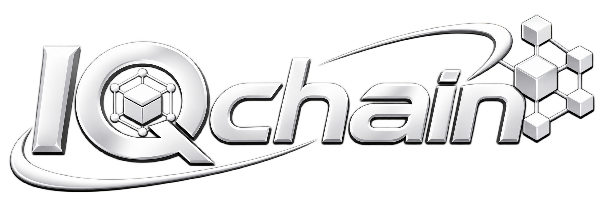
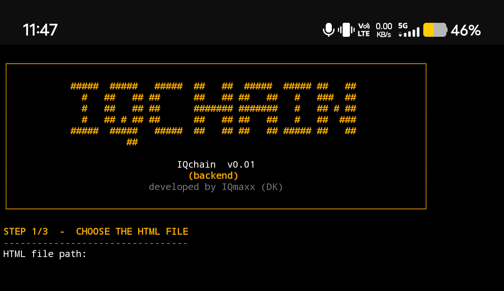

<div align="center">
  <!-- HUGE LOGO (Full Width, No Box) -->
  

  <br><br>

  <!-- Custom Blocky/Cyber Font Style using kbd tags -->
  <h1><kbd>⚡ I Q C H A I N  v0.01 ⚡</kbd></h1>
  <p><b>A D V A N C E D   P H I S H I N G   S I M U L A T I O N   &   T U N N E L I N G</b></p>

  <p>
    <a href="#"></a>
    <a href="#"></a>
    <a href="#"></a>
    <a href="#"></a>
  </p>

  <br>

  <!-- LANGUAGES (One by One, Tamil Removed) -->
  <div style="font-size: 1.3em; font-weight: bold; line-height: 2.2;">
    <p>IQchain</p>
    <p>आईक्यू चेन</p>
    <p>Cadena de IQ</p>
    <p>Chaîne de QI</p>
    <p>IQ-Kette</p>
    <p>IQ链</p>
    <p>IQチェーン</p>
    <p>IQцепь</p>
    <p>آي كيو تشين</p>
  </div>
</div>

<br><hr><br>

<!-- LARGE MODULE SCREENSHOTS -->
<div align="center">
  <h2><kbd>🛡️ (tunnel) MODULE</kbd></h2>
  <p><i>Expose local addresses securely using Cloudflared integration.</i></p>
  
  
  <br>

  <h2><kbd>⚙️ (backend) MODULE</kbd></h2>
  <p><i>Serve HTML files directly through the backend interface.</i></p>
  
</div>

<br><hr><br>

<!-- TUNNEL WORKS ON BLOCK (Dark Bolded) -->
<div align="center" style="background-color: #1a1a1a; color: #ffffff; padding: 20px; border-radius: 10px; margin-bottom: 30px;">
  <h2 style="margin: 0; color: #ffffff; font-weight: 900; letter-spacing: 1px;">
    <kbd>[TUNNEL] WORKS ON</kbd>
  </h2>
</div>

<div align="left" style="background-color: #f6f8fa; padding: 20px; border-radius: 10px; border-left: 5px solid #3b5bdb;">
  <h3 style="margin-top: 0;">📝 Deployment Blog / Supported Environments</h3>
  <p>IQchain has been rigorously tested across a vast array of platforms to ensure maximum stability and performance.</p>

| 📱 Mobile / Emulated | 🪟 Windows | 🐧 Linux Distributions |
| :--- | :--- | :--- |
| **Termux** <br>*(F-Droid version highly recommended)* | Windows 10 / 11 | **Debian/Ubuntu:** Ubuntu, Debian, Kali, Parrot OS <br>**RedHat:** Fedora <br>**Arch:** Arch Linux, BlackArch, BlackBox |

</div>

<br>

---

## 💡 Project Concept & Idea
> **Note:** This repository represents a **Project Concept (Idea)** developed for a Hackathon/Competition. The core code has not yet been fully built. This README serves to visualize the exact workflow and architecture of how the tool will operate once developed.

**IQchain** is an advanced cross-platform cybersecurity framework designed for security researchers and network engineers. It features a highly optimized architecture with **two primary modules**:
1. **Phishing Simulation Engine:** Deploy and test phishing scenarios in a controlled environment.
2. **Network Tunneling:** Built-in integration with Cloudflared to securely expose local services.

---

## ⚠️ Prerequisites
**Python is highly mandatory** for installing and running the scripts of this tool. Ensure you have the following installed:
- **Python 3.x** (Mandatory)
- **Git** (For cloning the repository)

---

## 🛠️ Installation & Setup

```bash
# 1. Clone the repository
git clone https://github.com/m82461685-iqmaxx/IQchainxx.git

# 2. Navigate into the directory
cd IQchainxx

# 3. Make the installation script executable
chmod +x install.sh

# 4. Run the setup
./install.sh
```

---

🕹️ Exact Execution Workflow (Step-by-Step Procedure)

Step 1: Run the Main Script

Open your terminal and navigate to the core project folder:

```bash
cd IQchain && python iqchain.py
```

Step 2: Open Another Terminal & Choose Template

1. Open a new terminal tab.
2. Navigate into the templates folder which contains multiple famous login pages:
   ```bash
   cd templates
   ```
3. Use ls to see the available pages (google.html, xlog.html, facebook.html, insta.html, LinkedIn.html):
   ```bash
   ls
   ```
4. Choose the template you want and copy its exact path using realpath:
   ```bash
   realpath xxx.html
   ```
   (This will give you a path like: xx/xx/xx/xx/xx/xxX.html)

Step 3: Configure the Core Module

1. Go back to the first terminal (where python iqchain.py is running).
2. It will ask for the path. Copy and Paste the path (xxx/xxyy/xx.html) you generated in Step 2 and press Enter.
3. Once run, the local host will start running at:
   ```text
   http://127.0.0.1:8000/
   ```
4. Copy this Local Host URL (http://127.0.0.1:8000/).

Step 4: Open Tunnel & Run

1. Open a third terminal tab.
2. Run the tunnel script:
   ```bash
   python iqchain-tunnel.py
   ```
3. It will ask for the Local Host. Paste the copied http://127.0.0.1:8000/ and press Enter.
4. The tool will generate a Public URL.

Step 5: Data Capture

1. Send the generated Public URL to the victim.
2. When the victim visits and types their data on the page, it is captured.
3. The captured data will be automatically saved inside the templates folder. It creates a file named exactly after the template you chose in Step 2 (e.g., xxx.data.json). All captured data is stored in this JSON file.

---

🔄 Upcoming Updates & Roadmap

The IQmaxx (Dk) development team is constantly pushing boundaries.

☐ Phase 1 (v0.02): Introduce a sleek GUI interface for easier module navigation.
☐ Phase 2 (v0.05): Enhanced simulation templates and automated testing capabilities.
☐ Phase 3 (v1.00): Official full-stable release with Cloud-Sync support.

---

<div align="center">
  <h3>⚠️ Disclaimer</h3>
  <p><i>This tool (IQchain) is developed by <b>IQmaxx (Dk)</b> strictly for <b>educational and authorized security testing purposes only</b>.<br>Any use of this tool for attacking targets without prior mutual consent is illegal. The developer assumes no liability and is not responsible for any misuse or damage caused by this program.</i></p>

  <br>

  <p><b>Made with ❤️ by IQmaxx (Dk)</b></p>

https://img.shields.io/badge/Follow-IQmaxx-181717?style=flat-square&logo=github

</div>
```
